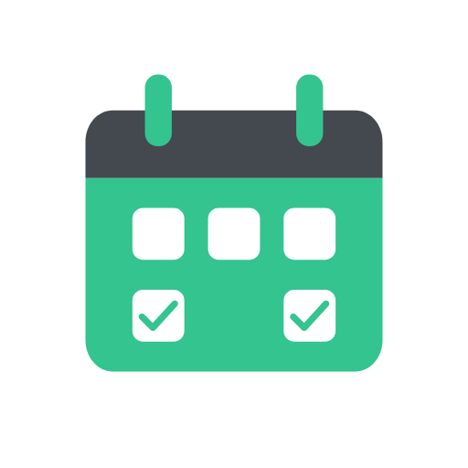

# Escala

**Sua escala de trabalho no Android, sem esquecer nenhum plantão** 📅

Para quem trabalha em ciclos de dias de trabalho e folga e quer ver tudo de relance.

---

## ✨ O que ele faz

Você informa quando começou e quantos dias trabalha e folga. O app repete o ciclo sozinho e mostra tudo no calendário.

### 📅 Ver a escala

| Onde | O que mostra |
|------|--------------|
| 🏠 **Cartão de hoje** | **Trabalho** em vermelho ou **Folga** em verde, com o horário ou o próximo dia de trabalho. |
| 🗓️ **Calendário** | Dias de trabalho, extras, trocas, férias e feriados marcados. Arraste para mudar de mês. |
| 📱 **Widget** | A mesma informação na tela inicial, sempre atualizada. |

Toque em um dia para **trocar** o que ele é, como uma troca de plantão ou um dia extra.

### ⏰ Alarmes

- 🔔 **Alarme de entrada**, no horário que você escolher.
- 🚪 **Alarme de saída**, no fim do turno.
- 📲 **Alarme garantido**: ocupa a tela toda e toca na hora certa, mesmo com o celular bloqueado.
- 🔁 Os alarmes voltam sozinhos depois de reiniciar o aparelho.

### 🗒️ Google Agenda

- Marca os dias de trabalho como evento de dia inteiro.
- Você escolhe o título, o local e a descrição.
- O passado é gravado uma vez só e nunca regravado.

### 🏖️ Férias e feriados

- Períodos de **férias**: nesses dias não há trabalho, alarme nem evento na agenda.
- **Feriados** do ano listados abaixo do calendário.

## 🎨 Aparência

- 🌗 Tema **Sistema, Claro ou Escuro**.
- ⚫ **Sete fundos escuros** à escolha: Preto, Petróleo, Marinho, Vinho, Grafite, Verde e Roxo.
- 🌈 **Seis cores de destaque** e a **Automática**, que acompanha o papel de parede (Android 12+).

## 📥 Instalar

1. Baixe o APK mais recente em **[Releases](https://github.com/wenesga/Escala-Trabalho/releases/latest)**.
2. Abra o arquivo no celular e permita a instalação de fontes externas, se o Android pedir.
3. Na primeira vez, o app guia as permissões: notificações, alarmes, tela cheia e bateria sem restrição.

Requer **Android 8 ou mais novo**.

## 🛠️ Tecnologia

Kotlin · Jetpack Compose · Material 3 · Glance (widget) · DataStore · WorkManager · AlarmManager · Calendar Provider

## 🔐 Privacidade

- Tudo fica no aparelho. O app não tem servidor nem conta.
- A agenda só é usada se você ligar o **Google Agenda**.

---

Feito com 💚 por [Wenes](https://github.com/wenesga)

